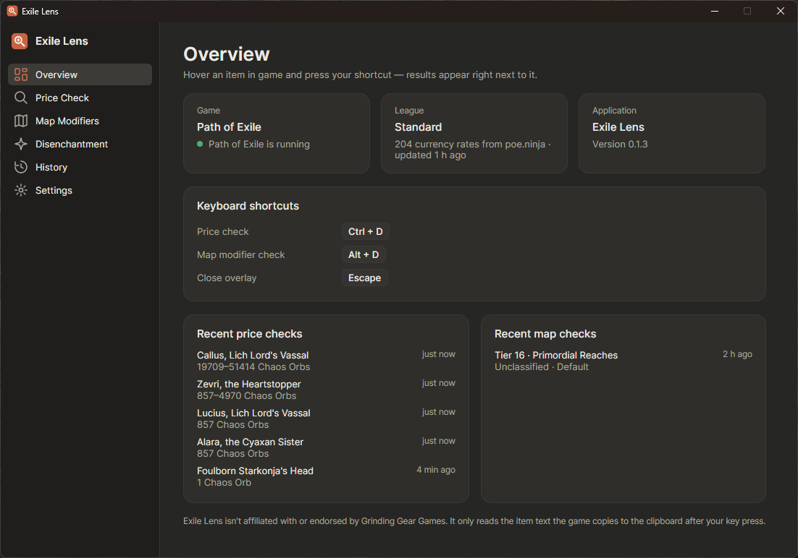
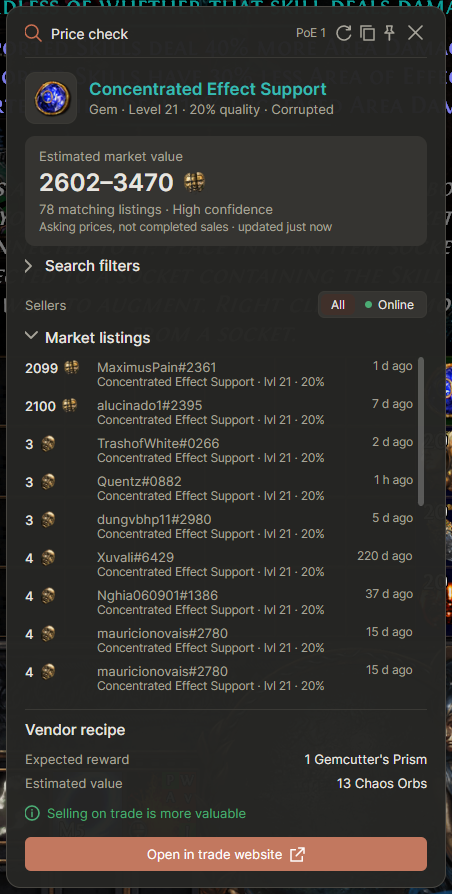
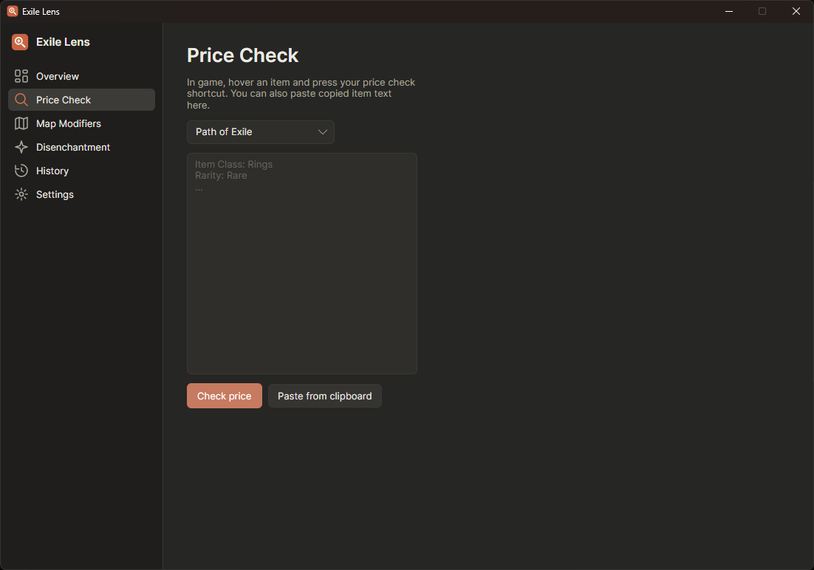
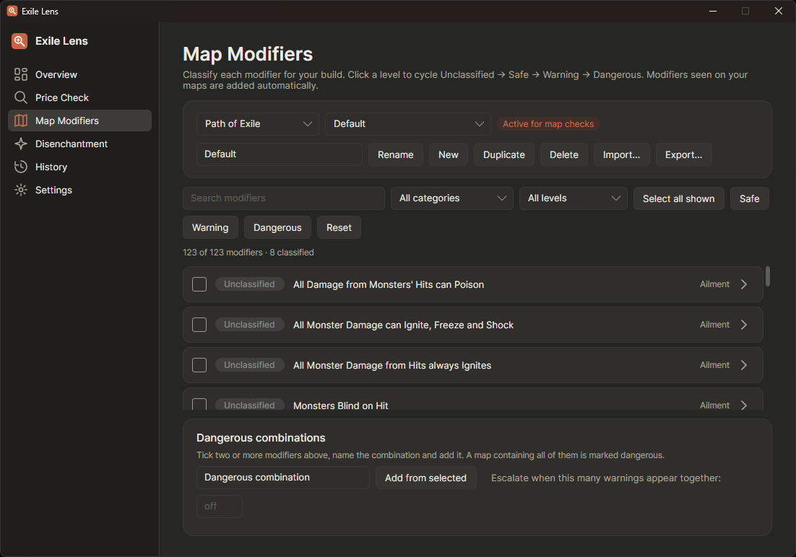
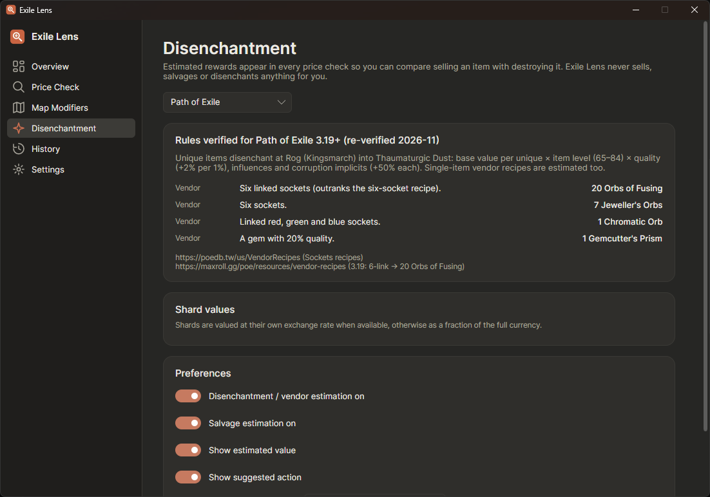
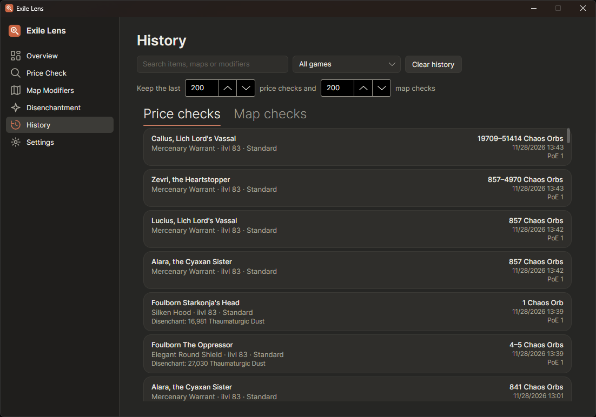
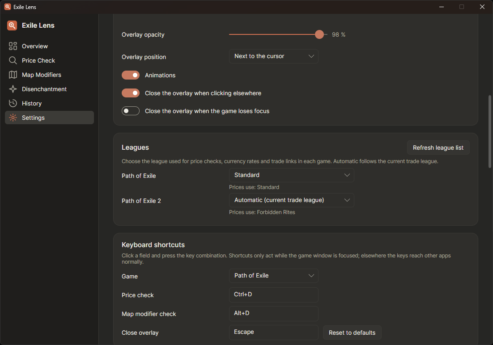

<h1 align="center">Exile Lens</h1>

<p align="center"><strong>Inspect smarter. Trade faster. Map safer.</strong></p>

<p align="center">
  A performance-focused, cross-platform item inspection and trading companion for Path of Exile and Path of Exile 2.
</p>

<p align="center">
  <a href="https://github.com/IgorBabayan/exile-lens/releases/latest"></a>
  
  
  
  <a href="LICENSE"></a>
</p>

<p align="center">
  <a href="https://github.com/IgorBabayan/exile-lens/releases/latest"><strong>Download</strong></a> ·
  <a href="#features">Features</a> ·
  <a href="#screenshots">Screenshots</a> ·
  <a href="https://github.com/IgorBabayan/exile-lens/issues">Report an issue</a>
</p>



## About

Exile Lens is a desktop companion designed for players who want quick access to market prices, build-specific map warnings and estimated disenchantment rewards without constantly switching between the game and a browser.

Built with C# and Avalonia on .NET 10, it prioritizes responsiveness, efficient resource usage and a consistent, warm dark interface across platforms.

## Features

### In-game price checking

- Hover over an item and press `Ctrl+D` to open a price-check overlay near the cursor.
- View estimated market value, matching listings and confidence indicators.
- Inspect seller names, listing prices and listing age.
- Refine search filters and switch between all and online sellers.
- Open matching results on the official trade website.
- Use league-specific currency exchange rates from poe.ninja.
- Paste item text manually into the desktop application.

<p align="center"></p>

Market estimates represent asking prices, not completed transactions.

### Map modifier analysis

Press `Alt+D` to analyze a map or waystone against your selected build profile.

| Classification | Meaning |
| --- | --- |
| 🟢 Safe | Suitable for your build |
| 🟡 Warning | Requires additional attention |
| 🔴 Dangerous | May be unsuitable for your build |
| ⚪ Unclassified | Not yet evaluated |

- Create separate profiles for different games and builds.
- Search and filter modifiers by category and severity.
- Classify modifiers individually or in bulk.
- Define dangerous combinations and escalate when multiple warnings appear together.
- Duplicate, rename, import and export profiles.
- Automatically record newly encountered modifiers as unclassified.

### Disenchantment, salvage and vendor estimates

Compare potential market value with alternative rewards before deciding what to do with an item.

- Path of Exile: Thaumaturgic Dust and supported single-item vendor recipes.
- Path of Exile 2: disenchantment shards and salvage rewards.
- Estimated currency values using available exchange rates.
- Suggested action based on the estimated alternatives.

All actions remain under the player's control. Exile Lens does not sell, salvage or disenchant items automatically.

### History and customization

- Search previous price checks and map analyses.
- Review item details, league, estimated value and timestamps.
- Configure history retention.
- Select leagues independently for each game or follow the current trade league automatically.
- Customize per-game shortcuts, overlay opacity, position, animations and closing behavior.

## Keyboard shortcuts

| Shortcut | Action |
| --- | --- |
| `Ctrl+D` | Check the hovered item's price |
| `Alt+D` | Analyze map modifiers |
| `Esc` | Close the overlay |

These are the default bindings. Shortcuts can be customized in Settings and are intended to activate only while the game is focused.

## Download and installation

Download the appropriate package from the [latest GitHub release](https://github.com/IgorBabayan/exile-lens/releases/latest).

| Platform | Architecture | Packages |
| --- | --- | --- |
| Windows | x64 | Setup `.exe`, portable `.zip` |
| Linux | x64 | `.AppImage`, `.tar.gz` |
| macOS | Apple Silicon and Intel | `.dmg`, `.zip` |

**Windows:** Run the installer or extract the portable archive and launch Exile Lens.

**Linux:** Make the AppImage executable, then launch it:

```bash
chmod +x ExileLens-*-linux-x64.AppImage
./ExileLens-*-linux-x64.AppImage
```

**macOS:** Open the DMG or extract the ZIP and move the application to Applications. The ad-hoc signed application may require right-click → Open on first launch. Grant Accessibility permission for keyboard shortcuts.

For best overlay compatibility, use windowed or borderless fullscreen mode. Linux Wayland support depends on XWayland and compositor capabilities; native Wayland has limitations. On macOS, overlays cannot appear over native fullscreen Spaces.

See [platform support and limitations](docs/PLATFORM-SUPPORT.md) for details.

## Screenshots

### Overview
Game status, currency rates, shortcuts and recent activity.


### Price Check
Manual item inspection through copied item text.



### Map Modifiers
Build profiles, severity classifications and dangerous combinations.



### Disenchantment
Reward rules, currency valuation and preferences.



### History
Searchable price and map check records.



### Settings
Overlay appearance, league selection and keyboard shortcuts.



## Technology

| Component | Technology |
| --- | --- |
| Language | C# |
| Runtime | .NET 10 |
| Desktop UI | Avalonia UI |
| Market data | Official Path of Exile trade website endpoints |
| Currency rates | poe.ninja |
| Distribution | GitHub Releases / GitHub Actions |

The project separates game-specific parsing and reward rules, application logic, infrastructure, UI and platform-specific integrations. It includes caching, request deduplication, cancellation and rate-limit handling to keep interactions responsive.

## Build from source

Install the [.NET 10 SDK](https://dotnet.microsoft.com/download/dotnet/10.0), then run:

```bash
git clone https://github.com/IgorBabayan/exile-lens.git
cd exile-lens
dotnet restore ExileLens.slnx
dotnet build ExileLens.slnx -c Release
dotnet test ExileLens.slnx -c Release
dotnet run --project src/ExileLens.App
```

Additional documentation:

- [Architecture](docs/ARCHITECTURE.md)
- [Data sources and rate limits](docs/DATA-SOURCES.md)
- [Platform support](docs/PLATFORM-SUPPORT.md)
- [Implementation status](docs/IMPLEMENTATION-STATUS.md)

## Game interaction and third-party policy

Exile Lens uses the game's built-in item-copy functionality in response to a user-initiated shortcut. It does not read game memory, inject code, modify game files, intercept network packets or automate gameplay or trading.

Trade requests are read-only and respect rate limits. Grinding Gear Games does not certify third-party tools; players should review the [third-party tool policy](https://www.pathofexile.com/forum/view-thread/2077975).

## Contributing

Bug reports, feature requests and pull requests are welcome. When reporting a problem, include your operating system, game version, application version and steps to reproduce it. Remove private information from copied item text or logs before sharing.

[Open an issue](https://github.com/IgorBabayan/exile-lens/issues)

## Credits and license

- [Grinding Gear Games](https://www.grindinggear.com/) — Path of Exile and its trade service.
- [poe.ninja](https://poe.ninja/) — economy and currency data.
- [poe.re](https://poe.re/) — Path of Exile map modifier catalog data.
- [Avalonia UI](https://avaloniaui.net/) — cross-platform desktop framework.

Exile Lens is distributed under the [MIT License](LICENSE).

Exile Lens is an independent community project and is not affiliated with or endorsed by Grinding Gear Games. Path of Exile and Path of Exile 2 belong to their respective rights holders.
